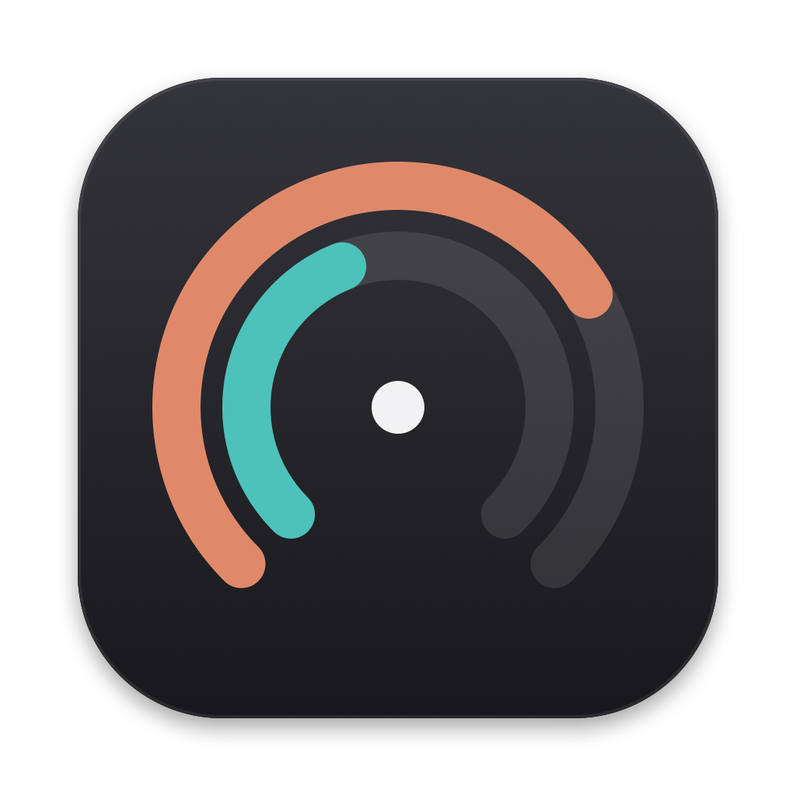
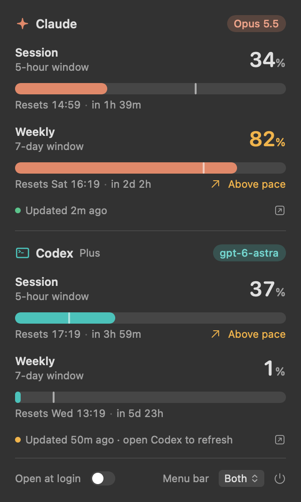
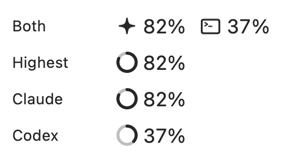

<p align="center">
  
</p>

<h1 align="center">Gauge</h1>

<p align="center">
  A tiny native macOS menu bar app that shows your <b>Claude</b> and <b>Codex</b> plan usage —
  how much of each limit you've used, and when it resets.
</p>

<p align="center">
  
</p>

## Features

- **Both limits for each tool**: the 5-hour session window and the weekly window
- **Reset times**, as a clock time and a countdown
- **Pace marker** on each bar: where you'd be if you spread usage evenly across the window. An *Above pace* warning appears when you're well ahead of it
- **Menu bar readout**: both tools side by side, the highest of the two, or just one

  

- **Private by design**: no network requests, no API keys, no logins. Gauge only reads files that Claude Code and Codex already write on your Mac
- About 700 lines of Swift in one file, with no dependencies

## How it gets the data

| | Source | Updates when |
|---|---|---|
| **Claude** | Claude Code passes your plan's `rate_limits` to its [status line](https://code.claude.com/docs/en/statusline) script. The included `statusline.sh` saves them to `~/.claude/usage-cache.json` | Claude Code redraws its status line, i.e. while you're using Claude Code |
| **Codex** | Codex logs `rate_limits` in its session files under `~/.codex/sessions/` | You send a message in Codex (CLI, IDE extension or desktop app) |

Gauge re-reads both every 15 seconds. When a window's reset time passes, it shows 0% even without new data. If the data is more than 30 minutes old, the dot next to "Updated" turns amber.

Claude limits require a Pro, Max or Ultra subscription. Usage from claude.ai on the web, or Codex in ChatGPT on the web, shows up the next time you use the local tool.

## Requirements

- macOS 14 (Sonoma) or later
- Xcode or the Command Line Tools (`xcode-select --install`) to build
- `jq` for the Claude status line script. It's included with macOS 15 and later; otherwise run `brew install jq`

## Install

```sh
git clone https://github.com/claudiaribeiro/gauge.git ~/code/gauge
cd ~/code/gauge
./build.sh
```

This builds `Gauge.app`, copies it to `~/Applications` and launches it. Turn on **Open at login** in the panel to keep it running.

### Claude: set up the status line

Add this to `~/.claude/settings.json` (adjust the path if you cloned elsewhere):

```json
{
  "statusLine": {
    "type": "command",
    "command": "~/code/gauge/statusline.sh"
  }
}
```

As well as saving your usage for Gauge, the script prints a status line under the Claude Code prompt:

```
Opus 5.5 · ctx 15% · session 36%, week 13% · +1014/−313 · open 1h56m (12m working) · cache 97%
```

That's context window used, plan usage, lines changed, session time, and the share of input tokens served from the prompt cache. Lower-priority parts are dropped as the terminal gets narrower.

If you already have your own status line, keep it and add one line to your script so Gauge still gets the data (it updates the cache and its own output is discarded):

```sh
echo "$input" | ~/code/gauge/statusline.sh >/dev/null
```

where `$input` is the JSON your script read from stdin.

### Codex

Nothing to set up. Use Codex as normal.

## Development

```sh
./build.sh                                            # build, install to ~/Applications, relaunch
build/Gauge.app/Contents/MacOS/Gauge --snapshot out.png dark   # render the panel with sample data
swift icon/make-icon.swift icon/AppIcon-1024.png      # redraw the app icon
```

Colours live in `Palette` in `Gauge.swift`.

## Caveats

- The Codex session log format isn't a public API, so a Codex update could change it and break the Codex section until Gauge is updated.
- The app is ad-hoc signed, not notarized, so you need to build it yourself.

## Disclaimer

Gauge is an independent project. It is not affiliated with, endorsed by, or sponsored by Anthropic or OpenAI. "Claude" and "Codex" are trademarks of their respective owners and are used here only to describe what the app works with.

## License

[MIT](LICENSE)
